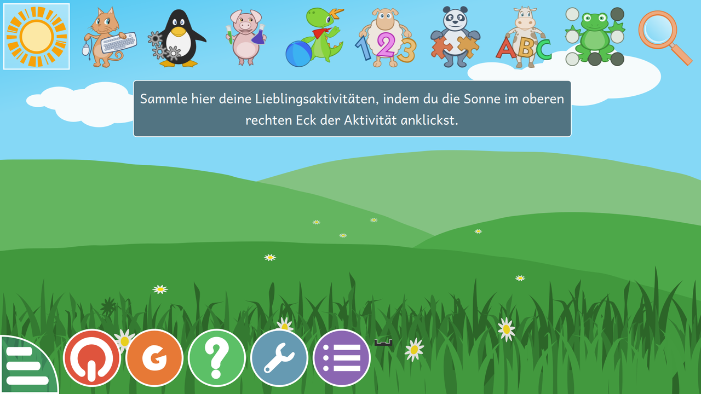
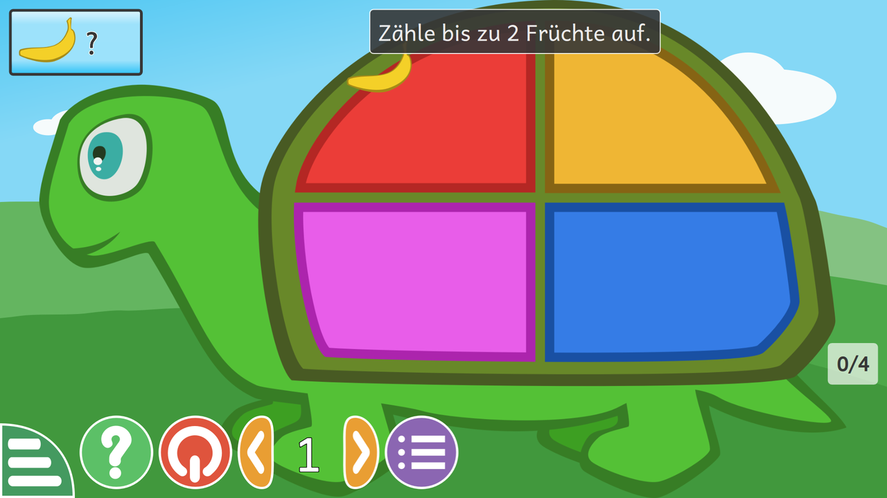

# Kazeta + GCompris: Lerncomputer zum Einstecken

Ein USB-Stick, der jeden halbwegs aktuellen PC in eine **Lernkonsole für Kinder** verwandelt:
einstecken, vom Stick starten, und nach wenigen Sekunden läuft
[GCompris](https://gcompris.net) im Vollbild, auf Deutsch, ohne Desktop, ohne Internet und ohne
dass etwas auf der Festplatte des Rechners verändert wird.

Das System darunter ist [KazetaOS](https://kazeta.org), ein Linux, das sich wie eine
Spielkonsole aus den 90ern verhält: Spiele stecken als „Cartridge“ auf einem Datenträger und
starten beim Einschalten sofort. Hier läuft Kazeta selbst vom Stick, und GCompris liegt als
Cartridge auf einer zweiten Partition desselben Sticks.



## Wofür ist das gut?

- **Für Kinder von 2 bis 10 Jahren:** GCompris enthält über 190 Lernspiele, unter anderem
  Zählen, Rechnen, Lesen, Buchstaben, Uhrzeit, Geografie, Logik, Malen, Musik und den Umgang
  mit Maus und Tastatur.
- **Ablenkungsfrei und sicher:** Es gibt keinen Browser, keinen App-Store, keine Werbung,
  kein Netzwerk und keine Konten. Das Kind kann das System nicht „kaputtklicken“, weil
  Kazeta schreibgeschützt ist.
- **Ohne Installation:** Ein alter Laptop, ein Mini-PC oder der Familienrechner wird nur
  vom Stick gestartet. Die eingebaute Festplatte bleibt unberührt, und ohne Stick startet
  der Rechner wie gewohnt.
- **Für Kita, Grundschule und Nachhilfe:** Mehrere Sticks lassen sich mit demselben Image
  beschreiben, jeder Stick ist ein vollständiger Lernplatz.
- **Wartungsfrei:** Es gibt keine Updates, die etwas ändern könnten. Das System startet
  in fünf Jahren genauso wie heute.



## Was steckt drin?

| Bestandteil | Version | Lizenz |
|---|---|---|
| [KazetaOS](https://github.com/kazetaos/kazeta) | 2025.08.21 | MIT (Basis: Arch Linux) |
| [GCompris](https://invent.kde.org/education/gcompris) (Linux 64 Bit) | 26.2 | GPL-3.0-or-later |
| [Kazeta-Linux-Runtime](https://github.com/kazetaos/kazeta/wiki/Runtimes) (umu + Steam Runtime „Sniper“) | 1.0 | siehe Upstream |

GCompris startet mit `--fullscreen` und deutscher Sprache (siehe [`cart/cart.kzi`](cart/cart.kzi)).

## Stick erstellen

Das fertige Image ist 29 GiB groß und passt auf jeden **USB-Stick ab 32 GB**. Ein USB-3-Stick
wird empfohlen, weil Kazeta direkt davon läuft. Wegen der Dateigrößen-Grenze von GitHub liegt
das Image gepackt (zstd) und in Teilen bei den
[Releases](https://github.com/jjochum-code/kazeta-gcompris/releases).

> **Achtung:** Beim Schreiben wird der gesamte Stick gelöscht. Prüfe das Zielgerät
> (`lsblk`) genau, ein falscher Buchstabe überschreibt sonst deine Festplatte.

### Linux

```bash
# alle Teile und SHA256SUMS aus dem Release herunterladen, dann:
sha256sum -c SHA256SUMS
cat kazeta-gcompris.img.zst.part-* | zstd -d | sudo dd of=/dev/sdX bs=4M conv=fsync status=progress
```

### Windows / macOS

1. Die Teile zu einer Datei zusammenfügen:
   Windows `copy /b kazeta-gcompris.img.zst.part-00 + kazeta-gcompris.img.zst.part-01 kazeta-gcompris.img.zst`
   (bei mehr Teilen entsprechend `+ …part-02` usw.),
   macOS `cat kazeta-gcompris.img.zst.part-* > kazeta-gcompris.img.zst`.
2. Mit [zstd](https://github.com/facebook/zstd/releases) entpacken: `zstd -d kazeta-gcompris.img.zst`
   (unter macOS z. B. per `brew install zstd`).
3. Die entstandene `kazeta-gcompris.img` mit [balenaEtcher](https://etcher.balena.io) auf den Stick schreiben.

Beim ersten Start mit einem größeren Stick bleibt der Platz hinter dem Image einfach ungenutzt.

## Benutzung

1. Stick an einen ausgeschalteten PC stecken.
2. Einschalten und im Bootmenü den USB-Stick wählen. Je nach Hersteller ist das meist
   F12, F11, F9, F8 oder Esc.
3. GCompris startet automatisch im Vollbild.
4. Beendet man GCompris, fährt der Rechner herunter.

Spielstände und Einstellungen speichert Kazeta auf dem Stick (Partition `frzr_root`, unter
`/var/kazeta/saves`). Jeder Stick merkt sich also den Fortschritt seines Kindes.

### Voraussetzungen am PC

- 64-Bit-PC (x86_64) mit **UEFI**. Alte BIOS-/Legacy-Rechner werden nicht unterstützt.
- **Secure Boot** und Intel RST im BIOS/UEFI **ausgeschaltet**.
- Mindestens 4 GB RAM.
- Grafik: AMD ab Radeon RX 400 oder Nvidia ab GTX 1600 läuft am besten. Intel-Grafik ab
  etwa 2017 funktioniert in der Regel, ist laut Kazeta aber weniger getestet.
- Ein Bildschirm. Laptops mit zwei Grafikchips (Hybrid-Grafik) werden nicht unterstützt.
- Maus oder Touchscreen. GCompris ist für die Maus gemacht, Gamepads sind optional.

## Aufbau des Sticks

| Partition | Größe | Inhalt |
|---|---|---|
| 1 `frzr_efi` | 1 GiB | Bootloader (systemd-boot) |
| 2 `frzr_root` | 24 GiB | KazetaOS (btrfs, unveränderliches System + Spielstände) |
| 3 `gcompris` | 4 GiB | Cartridge: `cart.kzi`, `icon.png`, `linux-1.0.kzr`, `content/` (GCompris) |

Kazeta hängt beim Start alle Datenträger unter `/run/media` ein, findet dort die
`cart.kzi` und startet das Spiel darin.

## Selbst bauen

Die Skripte in [`scripts/`](scripts) dokumentieren, wie das Image entstanden ist:

1. Das [Kazeta-Installations-ISO](https://kazeta.org) auf einen Stick schreiben, davon
   booten und Kazeta auf einen **zweiten** Stick (Ziel) installieren.
2. Auf dem Ziel-Stick die Kazeta-Partition verkleinern und dahinter eine ext4-Partition
   mit dem Namen `gcompris` anlegen. Wichtig: ohne casefold und ohne Leerzeichen im Namen.
3. Die Cartridge befüllen:
   [`scripts/build-cart.sh /run/media/$USER/gcompris`](scripts/build-cart.sh).
   Das Skript lädt GCompris und die Runtime, prüft GPG-Signatur und SHA256 und entpackt
   GCompris, ohne dessen Installer auszuführen.
4. Optional ein kompaktes Image erzeugen:
   [`sudo scripts/make-image.sh /dev/sdX <cart-verzeichnis> <ausgabe>`](scripts/make-image.sh).
   Das Skript liest den Stick nur, entfernt im Image Spielstände und Logs und verkleinert
   alles auf 29 GiB.

Mit `build-cart.sh` lässt sich GCompris auch als normale Cartridge auf einer SD-Karte
oder einem zweiten Stick für ein fest installiertes Kazeta anlegen.

## Bekannte Einschränkungen

- Kazeta ist offiziell für die Installation auf eine interne Festplatte gedacht. Der Betrieb
  direkt vom USB-Stick funktioniert, wird vom Kazeta-Projekt aber nicht offiziell unterstützt.
- Alle aus diesem Image erstellten Sticks haben dieselben Dateisystem- und Partitions-IDs.
  Der Bootloader sucht das System über den Partitionsnamen `frzr_root`. Deshalb nie zwei
  solche Sticks gleichzeitig einstecken, und nicht an einem Rechner booten, auf dem Kazeta
  (oder ChimeraOS) schon intern installiert ist.
- Die Screenshots stammen von genau diesem GCompris-Build, aufgenommen unter Linux im Vollbild.

## Lizenzen und Quellcode

- Die Skripte und Dateien in diesem Repository stehen unter der [MIT-Lizenz](LICENSE).
- **KazetaOS:** MIT, Quellcode unter <https://github.com/kazetaos/kazeta>. Das System
  enthält Pakete aus Arch Linux unter ihren jeweiligen Lizenzen; deren Quellcode ist über
  <https://gitlab.archlinux.org/archlinux/packaging/packages> bzw. das
  [Arch Build System](https://wiki.archlinux.org/title/Arch_Build_System) verfügbar.
- **GCompris:** GPL-3.0-or-later, © KDE / GCompris-Team. Unveränderter offizieller Build;
  Quellcode unter <https://invent.kde.org/education/gcompris> bzw.
  <https://download.kde.org/stable/gcompris/qt/src/>.
- **Kazeta-Linux-Runtime:** unverändert von <https://runtimes.kazeta.org>; enthält
  umu-launcher (GPL-3.0) und die Steam Runtime von Valve.

Dieses Projekt ist nicht mit dem Kazeta- oder dem GCompris-Projekt verbunden. Danke an
Alesh Slovak (Kazeta) und an das GCompris-Team für ihre großartige Arbeit.
